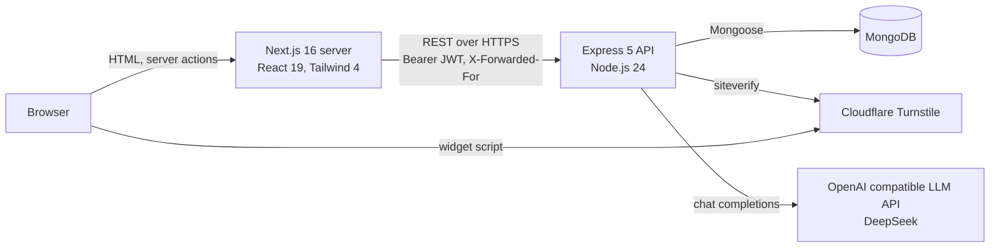

# 02. System Architecture

## Overview

The system has three tiers and two outside services.



The same diagram is kept in `diagrams/system-architecture.md` with more detail.

## Frontend

- **Next.js 16** (App Router) with React 19 and Tailwind CSS 4. Design tokens follow `DESIGN.md` (navy and white, sage for actions, Plus Jakarta Sans and DM Sans).
- **Rendering.** Cache Components and partial prerendering are on. Public pages are static. Anything that reads the session streams in behind a Suspense boundary, with `loading.tsx` skeletons.
- **Backend for frontend.** The browser never talks to the API. The Next.js server calls it from server actions, server components and one route handler. Benefits: the JWT is kept in an `httpOnly`, `SameSite=Lax` cookie that page scripts cannot read, there is no CORS surface, and the API address can stay private.
- **Session.** `lib/api.ts` reads the cookie and sends it as `Authorization: Bearer`. `lib/dal.ts` is the data access layer: `getCurrentUser()` and `requireUser(role)` redirect visitors to sign in or to their own dashboard.
- **Route protection.** `proxy.ts` sends visitors without a session cookie to `/login`. This is only a quick check. The real authorisation is in the data access layer and again in the API.
- **Forms.** Server actions with `useActionState`. Field errors from the API are shown next to each field and typed values are put back after an error. The submit form posts with a transition so its fields are never cleared.
- **Files.** `app/files/[id]/route.ts` streams an attachment from the API using the visitor's session. A link shared with another person returns "not found".
- **Captcha.** `components/turnstile.tsx` renders the Cloudflare widget and puts the token in a hidden field. The server action forwards it to the API.
- **SEO.** `lib/seo.ts`, root metadata, `sitemap.ts`, `robots.ts`, `manifest.ts`, `icon.svg`, JSON-LD, and `noindex` on every signed in page.

## Backend

`backend/src`, CommonJS, one folder per concern:

| Folder | Role |
| --- | --- |
| `config/` | `env.js` (validated settings), `db.js` (Mongoose connection), `constants.js` (roles, statuses, categories, transitions) |
| `models/` | Mongoose schemas, one file per collection, exported from `models/index.js` |
| `validators/` | Zod schemas for every request body, query and parameter |
| `middleware/` | `auth` (JWT), `rateLimit`, `turnstile`, `validate`, `upload`, `errorHandler` |
| `services/` | Business logic: `grievance.service` (workflow), `ai.service`, `stats.service`, `token.service` |
| `controllers/` | Thin request handlers that call services |
| `routes/` | Route tables, one file per area, mounted in `routes/index.js` |
| `utils/` | `AppError`, pagination, text similarity, serialisers |
| `scripts/` | `seed.js` demo data |

Request path: `helmet` and CORS, global rate limit, JSON body (20 KB limit), route, then for protected routes `authenticate`, `requireRole`, a route specific rate limit, optional upload, `verifyTurnstile`, `validate`, controller, service, database. Errors from any step end in one `errorHandler` that returns `{ error, code, errors? }`.

## Authentication and sessions

- Passwords are hashed with bcrypt (cost 10) and never returned.
- A login returns a JWT (HS256, 8 hours, issuer and audience set). Claims: subject, role, token version.
- `authenticate` verifies the token and then loads the user. It rejects the request if the user is gone, deactivated, or the token version no longer matches.
- Logging out increments the user's `tokenVersion`, which revokes every token issued earlier, on every device.
- Roles: `citizen`, `cmo`, `officer`. Officers carry a `department`.

## Authorisation model

- Route level: `requireRole(...)`.
- Record level, in `grievance.service.loadForUser`: citizens only get their own grievances, officers only grievances assigned to their department, the CMO everything. Anyone else gets "not found", so references cannot be probed.
- Field level: citizens never receive internal history entries, the AI duplicate list, assignment records, other people's feedback or action report files. The public tracking endpoint returns only status, department, district, category and timestamps.

## Database

MongoDB through Mongoose. Ten collections: `users`, `departments`, `grievances`, `grievancehistories`, `departmentassignments`, `attachments`, `feedbacks`, `contactenquiries`, `aianalyses` (plus MongoDB's own indexes). See [03_Database_Design.md](03_Database_Design.md) and `diagrams/database-er-diagram.md`.

Attachments are stored in MongoDB, not on disk, so they survive redeploys on hosts with a disposable filesystem. Uploads are capped at 5 MB, well under the 16 MB document limit.

## API

REST, JSON, under `/api`. Documented in [04_API_Documentation.md](04_API_Documentation.md).

## AI architecture

`services/ai.service.js` calls an OpenAI compatible `/chat/completions` endpoint (DeepSeek by default) with a fixed system prompt and JSON output. If no key is set, or the call fails, a keyword heuristic answers and the result is labelled `fallback`. The assistant's answer is stored in `aianalyses` so a citizen cannot forge it at submission. See [05_AI_Integration.md](05_AI_Integration.md).

## Abuse protection

- Cloudflare Turnstile on register, login, grievance submission and the contact form. Verified server side on every request, fail closed.
- Rate limits per route (see the API document), keyed by address, or by user for signed in actions.
- The Next.js server forwards the visitor's address in `X-Forwarded-For` and the API trusts one proxy hop, so limits apply to each visitor and not to the web server.
- Zod validation on every input, unknown fields stripped.
- Upload checks: extension and MIME type must agree, the file's first bytes must match its type, one file, 5 MB.
- `helmet` headers, no `X-Powered-By`, JSON body limit.

## Deployment shape

```
Browser  ->  Next.js (Vercel, Render or any Node host)  ->  Express API (Render, Railway or any Node host)  ->  MongoDB
```

Both apps are plain Node processes. Environment variables are listed in [06_Setup_and_Testing.md](06_Setup_and_Testing.md).
